  <!-- EN-TÊTE SVG -->
  
  
  <h1>👋 Salut, je suis Maé Nony !</h1>
  <h3>Développeur passionné | Créateur de solutions logicielles et web</h3>
  
  

    
    
    
  

 

## 🛠️ Mes Outils & Langages

> *Tu peux modifier la liste des icônes dans le lien ci-dessous en fonction de ce que tu maîtrises vraiment (ex: python, java, js, react, etc.)*

  

 

## 🚀 Projets & Réalisations

  
  

  
  

 

## 📊 Statistiques & Activité

  
  

  

---

  <i>Merci de ta visite ! ✌️</i> 
  

